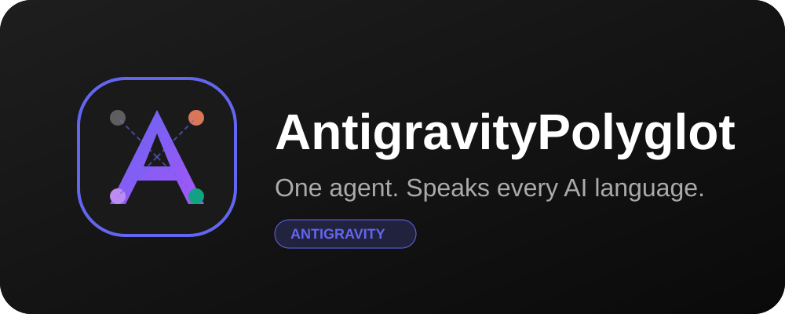

# 🌐 AntigravityPolyglot for Antigravity



**Antigravity now speaks Claude, Cursor, Copilot, Codex, and Gemini CLI fluently.** 🗣️ Stop translating your project rules by hand—AntigravityPolyglot is the ultimate linguistic bridge that makes Antigravity a true universal adapter in the AI engineering world.

---

## 🚀 Why Use This?

The AI engineering ecosystem is highly fragmented. Every agent platform has its own "dialect"—proprietary rulesets, custom tool definitions, and unique slash commands. Instead of choosing one agent or manually rewriting your instructions, **AntigravityPolyglot** bridges the gap, making Antigravity the most compatible agent in your toolkit.

### ✨ Key Features

- **🖱️ Cursor Master:** Effortlessly parse `.cursorrules` and modular `.mdc` instructions. Antigravity now respects your Cursor-specific "always/never" imperatives and path-based glob patterns.
- **🧱 Claude Code Bridge:** Full fluency in Claude's tool-calling dialects. Map `AskUserQuestion`, MCP server configs, and TypeScript `tool()` definitions directly to Antigravity's native capabilities.
- **🛰️ Copilot Navigator:** Antigravity now navigates modular `.github/skills/` and project-wide `.github/copilot-instructions.md` like a native. It even understands the multi-agent `AGENTS.md` standard.
- **📜 ChatGPT Codex Ingester:** Bring your custom system prompts, `*.codexrules`, and complex JSON function schemas from the Codex world into Antigravity without missing a beat.
- **⚡ Proactive Linguistic Guard:** Antigravity doesn't just wait for files—it proactively checks every activated skill for "foreign agent signatures" to ensure the right translation bridge is always active.
- **📂 Subfolder Workaround:** Speak the language of complex global skills by automatically syncing their nested resources to your local project context (nested neatly under `.agents/`).

---

## 🔥 Advanced Architecture & Optimizations

This refactored version of the Polyglot has been upgraded to a **Zero-Overhead Subagent Framework** designed to maximize speed, accuracy, and token economy:

### 1. 🎯 Lean Skill & Context Isolation
All heavy mapping tables, Zod schema converters, and platform routing directories have been moved **entirely out of the main prompt context and into the `@antigravity-polyglot` subagent**. 
* **The Benefit:** Your main conversation context remains 100% clean and lightweight, saving **up to 80% of your session tokens** and allowing the LLM to focus 100% of its cognitive weight on writing outstanding code.

### 2. ⚡ Double-Caching Hook Layer
We replaced flaky AI rule-lookup checks with a deterministic hybrid hook system:
* **Step 0 Memory Cache:** The system immediately checks session memory for a cached scan fact. If found, it bypasses filesystem crawls entirely for **instantaneous response times**.
* **Step 1 Deterministic Script Scan:** On a cache miss, the system executes a lightning-fast local Python scanner (`scripts/detect_patterns.py`) to scan files recursively in milliseconds, writing the scan result immediately to the memory cache.

### 3. 🤖 Dynamic Custom Subagent Synthesis
If a foreign skill attempts to spawn or communicate with its own custom-declared subagent (with specific prompts or rules), `AntigravityPolyglot` intercepts the call, dynamically registers it using Antigravity's **`define_subagent`** API, and executes it via **`invoke_subagent`** on-the-fly!

---

## 🛠 Installation & Scopes

You can install the lifecycle manager globally or per-project. Clone the repository and run:

```bash
# Run the interactive TUI installer
./scripts/setup.sh
```

### Scope Integrations:
* **Global Installation (`--install-global`):** Installs the skill globally, links the binary to `/usr/local/bin/antigravity-polyglot`, registers the subagent in `~/.gemini/agents/`, and hooks into the CLI's native hook engine.
* **Workspace Installation (`--install-workspace`):** Scaffolds a local pre-execution hook at `./.agents/hooks/pre-exec.sh` and registers the subagent locally inside the repo's `./.agents/agents/` folder.

---

## 📖 Usage

### Automated Rule Discovery
Once installed, AntigravityPolyglot acts as an invisible background interpreter. Whether you are using a skill built for Claude or a repository designed for Cursor, Antigravity will adjust its persona:

> **"I've detected Cursor rules and a Claude MCP skill. I'll translate their instructions to my native tools while adhering to your project's standards."**

### Multi-Agent Commands
Antigravity now understands slash commands from other ecosystems:
- `/compact` (Claude) - Triggers context cleanup and summarization.
- `/cost` (Claude) - Explains native cost metrics.
- Custom JSON Actions (Codex) - Automatically mapped to shell commands.

---

## 🏗 Priority Hierarchy

To ensure consistency, the adapter follows a strict linguistic priority:
1. **Antigravity Native Instructions** (Highest)
2. **Claude Code Rules**
3. **ChatGPT Codex Prompts**
4. **Cursor Rules** (Lowest)

---

## 📄 License
MIT © Bruno Andrade
